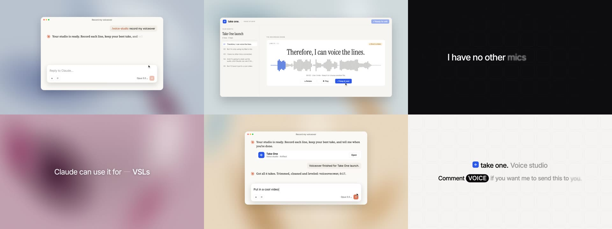

# launch-film

A 25–30 second launch film for your product, Claude skill or app, set in the Claude app and voiced by you. In 16:9 and 9:16.



It always tells the same story, so it works for anything:

- **The opener.** A pause, a dot, then gradient tiles cut on your music's first hit, with your wordmark after them.
- **The ask.** You type a short ask into Claude, Claude thinks, and hands back your product as a card. The cursor clicks Open.
- **One scene per line you recorded.** Your real product on screen with a click, a punchline in big dark type word by word,
  what it does ticked off as chips, a before/after you can hear, "use it for — reels / ads / anything", then back in Claude
  for the result, which opens full frame.
- **The end card.** Your wordmark, then your comment line word by word with the keyword as a black pill.

Every cut lands on the word you said it on, because the film is built from your recording's word timings, not guesses.

## Set it up in one paste

You need a Mac with [Node.js 18+](https://nodejs.org), ffmpeg (`brew install ffmpeg`) and Claude Code (the Code tab in
the [Claude desktop app](https://claude.ai/download) works). Your voice comes from the
[voice-studio](../voice-studio) skill.

Paste this into Claude Code:

```
Set up the launch-film and voice-studio skills from https://github.com/kjagsadvisors/keeran.ai for me.

1. Download the repo to a temporary folder and copy its launch-film and voice-studio folders to ~/.claude/skills/.
2. Run python3 ~/.claude/skills/launch-film/film.py setup and fix anything it says is missing.
3. Take me through voice-studio's Onboarding section, one step at a time.
4. Then ask me what my product is and what I'd say about it, so we can make my launch film.
```

## How a film gets made

1. **You say it, in your words.** Claude asks about your product and turns your answers into 5–7 short lines. You change
   whatever you want.
2. **You record it.** One line at a time in Take One (voice-studio), on your Mac's mic. Auphonic cleans it.
3. **You give it real screens.** Screenshots or screen recordings of your actual product. No mockups.
4. **Claude maps each line to a scene** in `film.json` and renders both sizes:

```bash
python3 film.py words films/my-product         # word timings
python3 film.py plan films/my-product          # every scene with its start time
python3 film.py render films/my-product --both # out/<title>-16x9.mp4 and -9x16.mp4, mastered to -16.4 LUFS
```

`examples/take-one/film.json` is the real Take One launch film. Start from it with `python3 film.py new films/my-product`.

## Music

The opener cuts on your track's first hit (`python3 film.py hits track.m4a` finds them). Use music you have the rights
to. None is included, and the film works without it: the clicks, keys and whooshes are synthesized and free to use.
