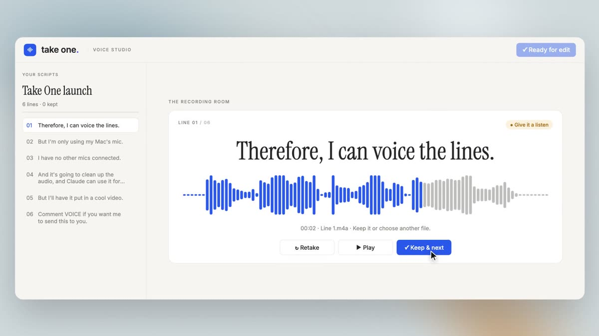

# voice-studio

Your own voice on your videos, with nothing but your Mac's mic. Claude builds you a voice studio called Take One and
installs it as an app on your computer. You record one line at a time, listen back, and keep the best take. Claude
pulls the takes out, cleans them up, and hands you one finished voiceover track.



- **One line at a time.** Fluff a line, redo that line. Nothing else changes.
- **No extra mic.** It records your Mac's built-in mic with Apple's own recorder, and checks every take for dropouts
  the moment you stop.
- **Cleaned by Auphonic.** Your takes go through [Auphonic](https://auphonic.com) on your own free account (2 hours of
  audio a month): leveling, noise reduction and loudness, with nothing cut out of your lines. Then the dead air is
  trimmed, every line is set to the same loudness, and the track is mastered for Reels, TikTok and YouTube.
- **Timed to your read.** You get where every line starts and ends, plus captions, so the video is built on how you
  actually said it.
- **Watch it where you recorded it.** Claude can put the finished video back in your studio.

## Set it up in one paste

You need a Mac and the [Claude desktop app](https://claude.ai/download) (the Code tab).

1. **Paste this into Claude Code:**

   ```
   Set up the voice-studio skill from https://github.com/kjagsadvisors/keeran.ai for me.

   1. Download the repo to a temporary folder and copy its voice-studio folder to ~/.claude/skills/voice-studio.
   2. Read its SKILL.md and take me through the Onboarding section, one step at a time. Run the commands yourself where you can.
   3. Once my studio is ready, give me the link and ask me what my voiceover is for and what I want to say.
   ```

   Claude installs the skill, checks your setup (ffmpeg, Apple's command line tools), and makes your studio: a
   private page in your Claude account that only you can open.

   **It also sets up Auphonic with you.** Claude opens Auphonic in your browser, you make a free account and copy an API
   key, and Claude saves the key in your Mac's Keychain and clears your clipboard. The key never lands in a file or the
   chat. You do this once.

2. **Get it as an app on your computer.** Open the studio link in the Claude desktop app and click **Install to record
   here** (or **Install as app** in the artifact's menu). Take One shows up in your Dock with its own window.

3. **Record.** Open Take One, press **Space** to record a line and **Space** again to stop. **P** plays it back,
   **Enter** keeps it and moves to the next line. The first time, macOS asks whether Claude can use the microphone,
   and Claude asks whether Take One can run its recorder: say yes to both.

4. **Tap Ready for edit**, then tell Claude "Voiceover finished for <your title>". After the first time, this is all you
   type:

   ```
   /voice-studio voiceover for my launch video. Here's what I want to say: ...
   ```

On your phone, or a Windows PC, you can still use the studio: record each line in Voice Memos (or any recorder) and
drop the file on its card.

## What you get

In `voice/<title>/`:

| | |
|---|---|
| `voiceover.wav`, `voiceover.mp3` | the finished track: trimmed, cleaned, every line the same loudness, mastered to -16 LUFS |
| `lines/01.wav` ... | each line on its own |
| `timings.json` | where each line starts and ends |
| `captions.srt` | one caption per line, for CapCut, Premiere or YouTube |

## Install by hand

Copy this folder into `~/.claude/skills/` (or your project's `.claude/skills/`). It needs Python 3.9+, ffmpeg
(`brew install ffmpeg`), numpy (`python3 -m pip install --user numpy`), a free Auphonic API key
(copy it, then `python3 voice_studio.py auphonic-key`) and, to record inside the app, Apple's command line tools
(`xcode-select --install`). The
studio's recorder is built from `recorder/takeone-rec.swift` the first time you press Record.
